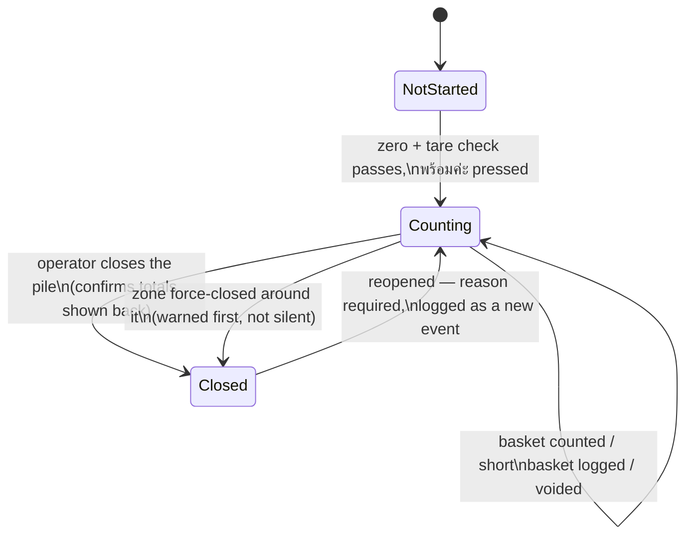
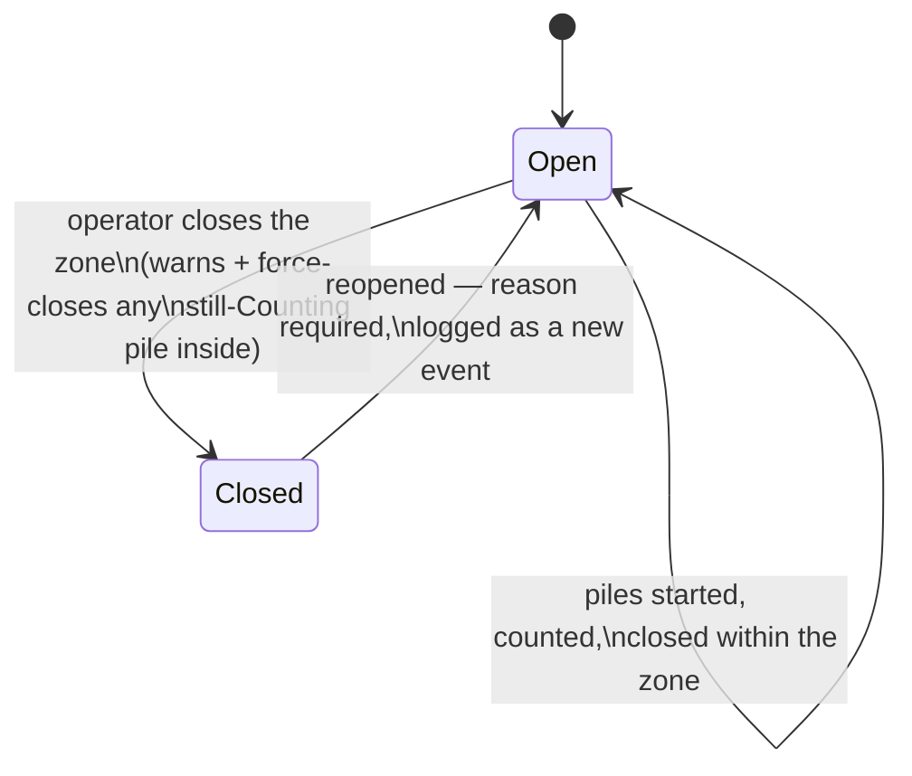
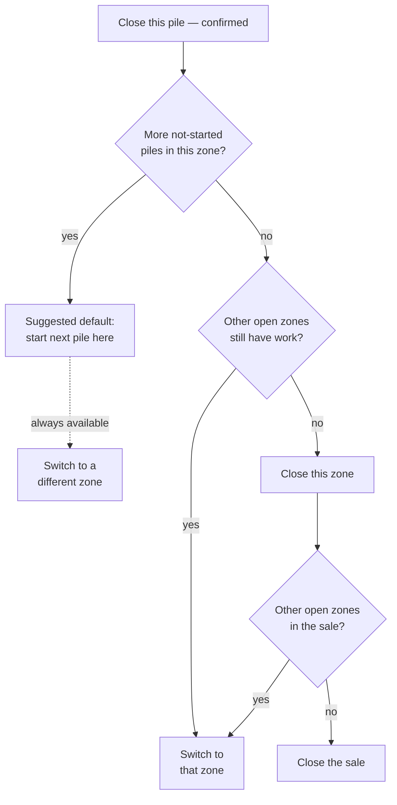
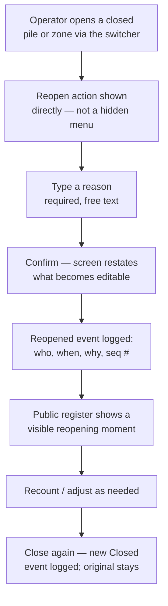

# Pile, Zone & Sale Lifecycle — User Journey

> Status: **Design-phase UX finding**, not a decision. Extends
> `docs/ux/counter-screen-findings.md` (F-19, F-20) and the working
> prototype in `docs/ux/counter-screen-full.html`. Written so a dev, a QA
> pass, and UI design can each act on it directly — state model, the
> operator's actual journey through it, a transition table precise enough
> to implement against, and the questions still open for the PRD.
>
> Nothing here has been prototyped yet beyond the close-pile and
> close-zone flows already in `counter-screen-full.html`. Closing the
> whole sale, and reopening anything, are proposed here for review before
> they're built.

## 1. Why this needs its own document

The counter screen prototype closes a pile and closes a zone. Two
questions it doesn't yet answer, both raised in review:

1. **After closing something, where does the operator go?** Right now,
   closing the last pile in a zone dumps the operator into the raw
   zone/pile switcher with no guidance. That's a real gap — a sale
   normally moves through several zones in sequence, and eventually has to
   *end*, and neither of those is designed yet.
2. **What happens when a closed pile or zone needs to change?** Nothing
   does, currently — closed is permanent. Real selling doesn't work that
   way: a pile gets closed early by mistake, a buyer disputes a total
   after the fact, a zone gets force-closed around a pile that was still
   mid-count. The system needs a way back in that doesn't compromise the
   audit trail or the trust model FR-9 is built on.

Both are addressed below as one connected journey, because they're the
same underlying question — **what can happen to a pile/zone/sale once it
leaves its default state, and how does the record show it honestly.**

## 2. Terms

Same hierarchy as `docs/prd.md`'s domain model: a **sale** covers one or
more **zones**, a zone covers one or more **piles** (FR-4.3). This
document adds a **status** to each of the three levels and defines what
moves a level between statuses.

## 3. State model

Three independent state machines, one per level. They interact — closing
a zone can force-close a pile, closing a sale can force-close a zone — but
each level's own states are simple.

### 3.1 Pile



### 3.2 Zone



Reopening a zone does **not** cascade into its already-closed piles. It
only lifts the zone-level lock — the operator can start a new pile there,
or separately reopen a specific pile that was force-closed when the zone
closed around it. Two closed things need two reopen actions; neither one
implies the other. This keeps the blast radius of each action small and
legible, the same principle F-20 already established for the warn-not-
block rule on zone close.

### 3.3 Sale

```mermaid
stateDiagram-v2
    [*] --> Open
    Open --> Open: zones opened and closed,\npiles counted throughout
    Open --> Closed: operator closes the sale\n(warns + cascades any\nstill-open zone)
    Closed --> Open: reopened — highest friction\nof the three; see §8.5
    Closed --> [*]: settlement (FR-7) — a\nseparate screen, out of scope here
```



Closing the sale is the boundary between this document's scope and FR-7
Settlement. What happens on the settlement screen isn't specified here.

## 4. The journey after closing a pile

This is the concrete gap: right now, closing a pile just shows a
transition card and either jumps to the next not-started pile or dumps
the operator into the raw switcher. It should instead be a real decision
point, because there are genuinely four different things that might be
true next.



The **suggested default** (start the next pile in the same zone) matches
what already happens most of the time — a sale usually works through one
zone's piles before moving on — but it should never be the *only* option
on screen. "Switch zone" and "close this zone" belong as visible, one-tap
alternatives at the same moment, not buried behind the switcher's
breadcrumb button. This is the concrete fix for the gap you flagged:
closing a pile should hand the operator three or four clearly labelled
next steps, not a bare "continue."

## 5. Closing a zone → the same decision, one level up

Once a zone closes, the same shape of question repeats: another zone with
work left, or the sale is done. The confirmation panel (already built)
shows the zone's rollup and warns if a pile is still `Counting` inside it;
what's new here is what comes *after* confirming — a "next zone" or
"close the sale" prompt, mirroring §4's pile-close flow one level up
rather than leaving the operator to find their own way via the
breadcrumb.

## 6. Closing the sale

Not yet built. Proposed shape, consistent with the pile/zone pattern
already established:

- Available at any time — including a sale with very little counted, worded
  honestly ("1 zone, 12 baskets, 600 kg — close this sale?") rather than
  gated behind an artificial minimum, matching the same "0 baskets, close
  anyway?" honesty already used at pile-close.
- The confirmation shows the **whole-sale rollup**: every zone, every
  pile, standard vs. short-basket weight, total. This is the first time in
  the journey the operator sees one number for the entire sale.
- If any zone is still `Open` with a pile still `Counting`, the
  confirmation names it and warns, then cascades the same force-close
  behavior zone-close already uses on its piles — closing the sale closes
  everything under it, never silently.
- On confirm, the sale becomes `Closed`. What happens next — the handoff
  to FR-7 Settlement — is a different screen and out of scope here, but
  the boundary matters: **once the sale is `Closed`, no pile or zone
  under it can be reopened without first reopening the sale itself**
  (§8.5). Settlement math shouldn't be able to shift under someone once
  it's been computed from a number both sides may have already seen as
  final.

## 7. Reopening and adjusting — why, and how

### 7.1 Why this has to exist

None of these are edge cases; all of them will happen in a real selling
season:

- A pile gets closed by mistake — a fat-fingered tap, or the operator
  miscounted how many baskets were physically left.
- A basket gets weighed *after* the close action is tapped — a timing
  race between the field and the screen.
- A zone gets force-closed around a pile that was still mid-count (the
  scenario F-20 already warns about but doesn't resolve — the warning
  lets the close through, so something has to let the operator back in).
- A buyer disputes a total after the fact and both sides want to recount.

A system that can't handle any of these will get "corrected" outside the
app instead — on paper, after the fact, exactly the failure mode this
whole product exists to remove.

### 7.2 Design principles

**Reopening is a new event, not an undo.** The original `Closed` event
stays in the log forever, unedited. A `Reopened` event is appended —
actor, reason, timestamp, sequence number. When the pile or zone closes
again, a new `Closed` event is appended too. Nothing is overwritten;
the log reads as a true history — closed, reopened (why), closed again —
the same append-only model NFR-3 and FR-12 already require for corrections,
extended to cover this new kind of correction.

**Confirmation friction should scale with the action's reach.** Voiding
one basket (already built) is one tap plus a reason chip — it affects one
number, and it's used often enough that friction there just gets ignored.
Reopening a whole pile or zone is different: it makes an already-shown
total editable again, potentially after a buyer has already treated it as
final. Recommendation: a **typed reason**, not a canned chip — the space
of "why is a closed record being reopened" doesn't fit a short fixed
vocabulary the way "why did you void a basket" does — plus an explicit
restatement of consequence ("this pile's total becomes editable again; a
recount may change the number anyone already saw") before a second,
deliberate confirm tap.

**Reopening a pile the ล้ง already watched close is a transparency event,
not just a data event.** This is the sharpest point in this whole
document, and it follows directly from FR-9: the count is trustworthy
*because* it was watched happening, in public, in real time. If a closed
pile gets silently reopened and recounted with nothing changing on the
public register, the transparency guarantee breaks at exactly the moment
it matters most — the correction. **Recommendation: reopening should be
its own visible, public moment on the same register that shows the
count** — a full-screen "reopening กอง 1 — recounting" state, the same
device already used for pile transitions (F-4), ideally spoken aloud too
(extending FR-11's announcement pattern to this new event). The mechanism
that makes the original count trustworthy has to cover its own correction,
or the correction is the one number nobody was watching.

**Scope stays small.** Reopening a zone doesn't reopen its closed piles
(§3.2); reopening a pile doesn't require reopening its zone unless the
zone itself is also closed. Each action does the smallest thing that
solves the actual problem.

**A hard boundary at the sale.** Once the sale is `Closed`, pile and zone
reopening are blocked until the sale itself is reopened first (§8.5) —
one clean line between "still counting" and "handed to settlement,"
because letting a pile's count move after settlement math has been shown
to both sides would undermine the exact trust the product is for.

### 7.3 The reopen flow



### 7.4 Worked example — what the log actually shows

A pile closed at 87 baskets, reopened for a recount, closed again at 89:

```
#142  system   pile closed · 87×50+120 short = 4,470 kg
#143  operator reopened · "buyer wants to recount, thinks we're short two"
#151  hold     counted · 2+50=52 กก. (standard)
#152  hold     counted · 2+50=52 กก. (standard)
#153  system   pile closed · 89×50+120 short = 4,570 kg
```

Every number anyone asks about is answerable straight from this: what it
was, why it changed, and what it is now. Nothing was edited in place.

### 7.5 Who can reopen — an open question, not answered here

The PRD doesn't yet specify per-role permissions (NFR-6 already flags this
as open: "what exactly each role may see and do"). This document doesn't
answer it either — but it depends on that answer, so it's worth flagging
precisely: reopening a closed pile or zone is at least as consequential as
starting or closing one, and whatever role gets to do the latter is the
natural candidate for the former. Left to `docs/architecture.md` /
`docs/prd.md`.

There's a second, harder open question here too: **the buyer isn't in the
app** (FR-9.5 — that's what makes an owner-only v1 coherent). The public
register and spoken announcement (§7.2) give the ล้ง visibility into a
reopen *while they're standing there*, but there's no mechanism at all for
their acknowledgment if a pile gets reopened **after** they've left. That
gap is inherent to the v1 model, not something this document can design
around — worth naming rather than quietly assuming away.

## 8. Transition rules

Precise enough to implement against directly.

| From | Action | To | Guard | Logged as |
| --- | --- | --- | --- | --- |
| Pile: NotStarted | Zero + tare check, then Ready | Counting | — | `ready` system event |
| Pile: Counting | Count a basket | Counting | pile is Counting | `accept` |
| Pile: Counting | Log short basket | Counting | pile is Counting | `short` |
| Pile: Counting | Close pile | Closed | — (0-basket close allowed, worded honestly) | `pile closed · …` system event |
| Pile: Counting | Zone force-closes around it | Closed | zone close confirmed with warning shown | `pile closed (forced by zone close)` |
| Pile: Closed | Reopen | Counting | reason provided; sale is Open | `reopened · reason` |
| Zone: Open | Close zone | Closed | — (0-pile close allowed); any Counting pile inside is force-closed first, named in the warning | `zone closed · …` |
| Zone: Closed | Reopen | Open | reason provided; sale is Open | `zone reopened · reason` — does **not** reopen piles |
| Sale: Open | Close sale | Closed | any Open zone is force-closed first, named in the warning | `sale closed · …` |
| Sale: Closed | Reopen | Open | reason provided (highest friction of the three) | `sale reopened · reason` |
| Sale: Closed | — | (handoff) | — | Settlement (FR-7), separate screen, out of scope |

## 9. QA scenarios to verify once this is built

Continuing the pairing established in `counter-screen-full.html`'s notes —
each of these is a real way the journey above can be gotten wrong:

- Close the **last** pile in a zone, then the **last** zone in a sale, back
  to back, with no manual navigation — the "close sale" prompt should be
  reachable without ever touching the switcher.
- Close a zone while one of its piles is still `Counting`; confirm the
  warning names that exact pile, and that the pile shows as `Closed` (not
  orphaned in some third state) immediately after.
- Reopen that same force-closed pile; confirm the zone did **not** also
  silently reopen, and that starting a new pile in that zone still
  requires reopening the zone separately.
- Try to reopen a pile or zone while the **sale** is `Closed` — must be
  blocked, with the message pointing at reopening the sale as the actual
  next step, not a dead end.
- Reopen a pile, recount it, close it again — read the log back and
  confirm the original close, the reopen with its reason, and the new
  close are all present and in the right order (sequence number, not wall
  clock, per FR-12.5).
- Close a sale with **one zone untouched** (still `Open`, zero piles
  started in it) — confirm this is allowed and worded honestly, not
  blocked on an arbitrary "every zone must be used" rule.
- Attempt every reopen action with an **empty reason** — must be rejected
  client-side before it ever reaches the log; an audit trail with a blank
  "why" defeats its own purpose.

## 10. What this means, per discipline

**Dev** — the state model in §3 and the transition table in §8 are the
implementation contract: three independent status fields (pile, zone,
sale), each with exactly the transitions listed, each transition
producing exactly one immutable log event. Nothing here needs a fourth
status value or a state not listed above; resist the urge to add one.

**QA** — §9 is a starting checklist, not an exhaustive one; the general
pattern worth hunting for more of is *"what happens when a broader scope
closes or reopens around a narrower one that's mid-action"* — that seam
(zone/pile in this document, and by extension sale/zone) is where the
real bugs will cluster, based on how many of this document's own
recommendations exist specifically to close gaps like it.

**UI design** — §4's decision point (three or four labelled next steps
after a pile closes, not a bare "continue") and §7.2's public reopening
moment are the two screens with no prior art in this project to draw
from; everything else extends a pattern (confirmation panels, the
transition card, the event log) already designed and reviewed elsewhere
in `docs/ux/`.

## 11. Relationship to other docs

- Extends `docs/ux/counter-screen-findings.md` (F-19 tabs/persistent
  count, F-20 zone-close guard) up one level, from "how the screen is laid
  out" to "how a sale actually moves through it."
- The reopen mechanism is a direct application of NFR-3 (append-only,
  no destructive edits) and FR-12 (full event log, sequence-ordered) to a
  case those requirements didn't explicitly anticipate.
- §7.5's open questions belong to `docs/prd.md` (role permissions,
  NFR-6) and are flagged, not answered, here.
- §6's sale-close handoff is the boundary with FR-7 Settlement, which is
  a separate screen not designed in this document.
